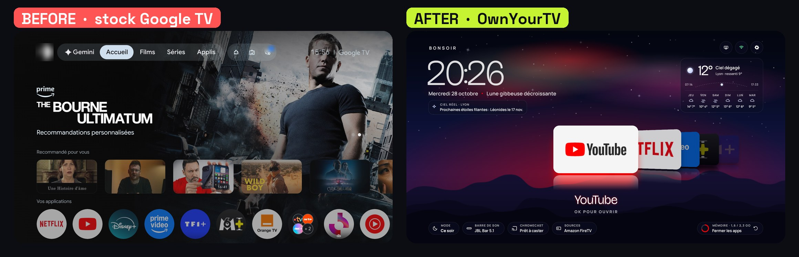
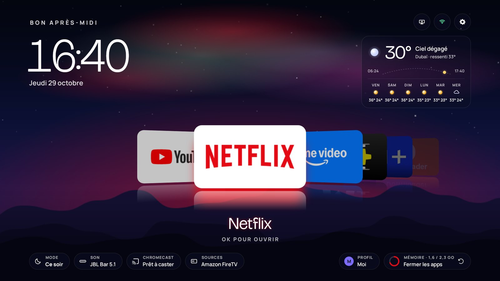
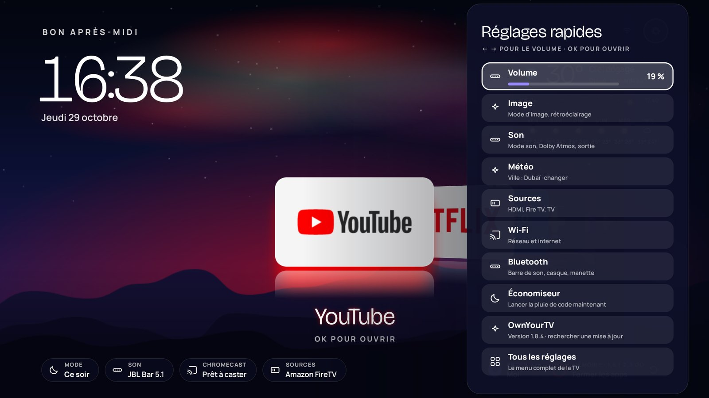
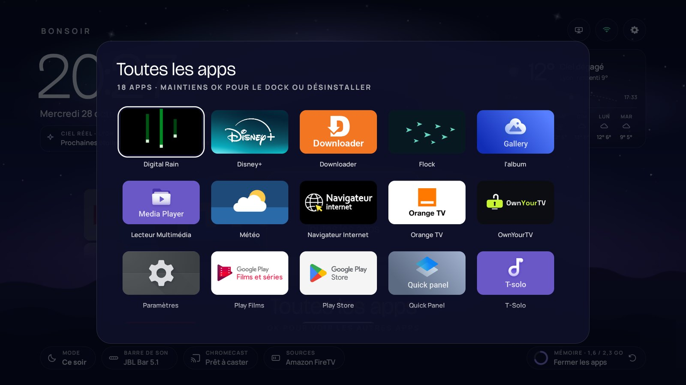
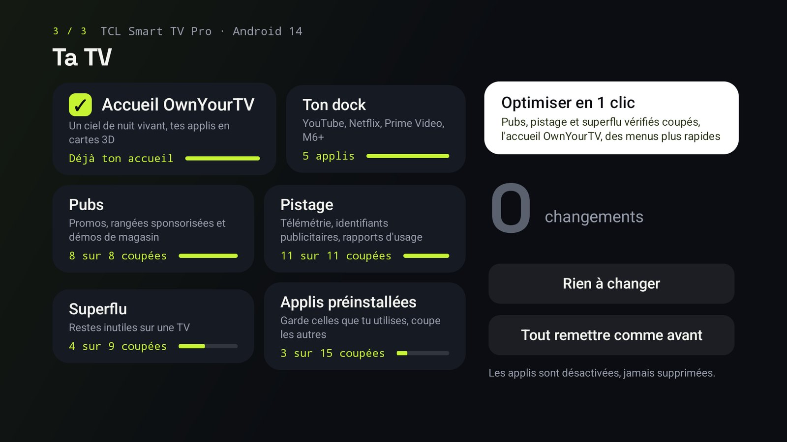
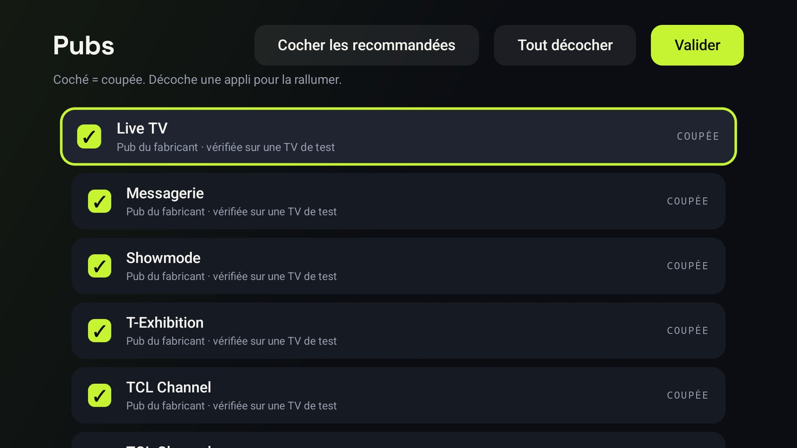
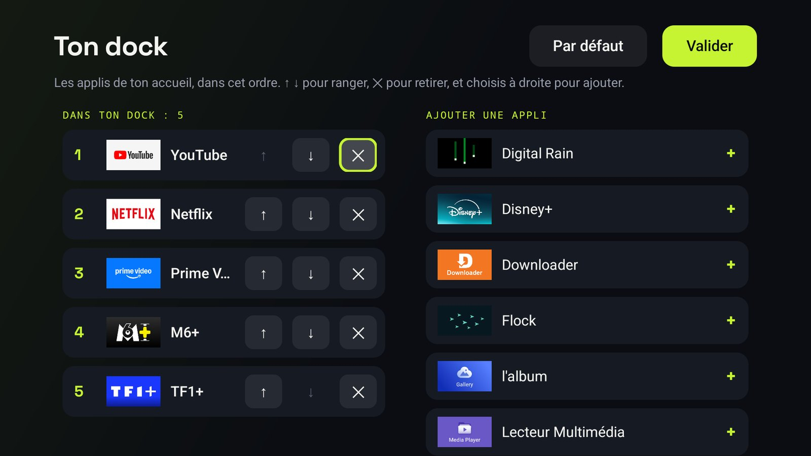

<p align="center"></p>

<h3 align="center">You paid for it. Own it.</h3>

<p align="center">Switch off the ads and tracking your Android TV or Google TV came with, and give it a home screen
that is yours. From the remote, no computer needed.</p>

---

<p align="center"><b>Install from your TV: in the Downloader app, type <code>8225348</code></b></p>

<p align="center"></p>

## What it does

- **Ads**: promos, sponsored rows and store demos the maker put on your TV.
- **Tracking**: telemetry, advertising IDs and usage reports.
- **Clutter**: leftovers nobody uses on a TV.
- **Preinstalled apps**: keep the ones you use, switch off the rest.
- **A home screen of its own**: A night sky with shooting stars, an aurora that takes the colour of the app you
  pick, your apps as a 3D deck of cards, the weather, quick settings on the remote's gear button.
- **One button puts everything back.** Apps are switched off, never deleted.

In English, French, Spanish, German, Italian and Portuguese, following your TV's language.

## Screenshots

Taken on a TCL C89B, Google TV 14.

| | |
|---|---|
|  |  |
| **The aurora takes the colour of the app you pick**, and Continue watching picks up where you left off | **Quick settings** on the remote's gear button |
|  |  |
| **All apps**: hold OK to add one to the dock or uninstall it | **Your TV**: everything on one screen, and **Optimise in one click** |
|  |  |
| **App by app**, with a tick box each; untick one to switch it back on | **Your dock**: pick the home screen's apps and their order |

## Three ways to install

| | How | You need |
|---|---|---|
| **On the TV** | In [Downloader](https://www.aftvnews.com/downloader/), type the code **8225348**, install, then follow the app | Just the remote |
| **From a computer** | `python3 ownyourtv.py <tv ip>` ([below](#from-a-computer)) | Python 3, adb |
| **With an AI agent** | Paste [PROMPT.md](PROMPT.md) into Claude Code | Claude Code, adb |

Every route uses the same catalogue (`data/catalog.json`) and the same safety rules: what Android or the TV needs to
start, play a channel or an HDMI input, take a remote, a keyboard or a network is never offered.

## From a computer

Everything the TV app does, from a terminal on Windows, macOS or Linux.

1. Install **adb**: [Android platform-tools](https://developer.android.com/tools/releases/platform-tools)
   (macOS: `brew install android-platform-tools`, Windows: `winget install Google.PlatformTools`,
   Linux: `sudo apt install adb`), and **Python 3**.
2. Download this repository (`git clone https://github.com/pimado1/ownyourtv` or Code › Download ZIP).
3. On the TV: Settings › System › About › click "Android TV OS build" 7 times, then Settings › System ›
   Developer options › USB debugging. Note the TV's IP address (Settings › Network).
4. Run:

```bash
python3 ownyourtv.py 192.168.1.50
```

A menu opens: **Optimise in one click**, **Choose apps one by one**, **Install the OwnYourTV home**, **Put
everything back**, **Done** (switches USB debugging off). The TV asks once whether to allow the computer.

The same, without the menu:

| Command | What it does |
|---|---|
| `python3 ownyourtv.py <ip> optimise` | Verified ads, tracking and clutter off, the OwnYourTV home, faster animations |
| `python3 ownyourtv.py <ip> list` | What can be switched off, and what already is |
| `python3 ownyourtv.py <ip> off <app> …` / `on <app> …` | Switch apps off, or back on |
| `python3 ownyourtv.py <ip> home` | Install OwnYourTV and make its home the TV's home |
| `python3 ownyourtv.py <ip> undo` | Put back everything the script changed |

Add `--yes` to skip the questions. The script and the TV app share the catalogue and the safety rules; each
keeps its own record of what it changed, so undo each from where you made the change.

### Updating from 1.0 or 1.1

Version 1.2 is signed with OwnYourTV's own key, so it cannot update a 1.0 or 1.1 install. In OwnYourTV, press
**Put everything back** first (so the TV gets its original home back), then uninstall OwnYourTV (Settings › Apps)
and install 1.2. `ownyourtv.py <tv ip> home` does all of it for you when you agree.

## How the TV app works without a computer

Android lets the owner turn on USB debugging. When it is on, OwnYourTV connects to the TV's own debugging port,
the TV asks you once whether to allow it, and from then on the app can switch apps off and set the home screen,
the way a computer would. Nothing leaves the TV. When you are done, "Finish and lock" turns debugging off again.

## Add your TV

Apps are ticked by default only once they have been checked on a real TV. See [CONTRIBUTING.md](CONTRIBUTING.md).

## Build

```bash
./gradlew assembleRelease
```

The APK is `app/build/outputs/apk/release/app-release.apk`. JDK 17 and the Android SDK (34) are needed.

## Licence

MIT, see [LICENSE](LICENSE). Third-party components are listed in [NOTICE.md](NOTICE.md).

---

### En français

**Tu l'as payée. Elle est à toi.** OwnYourTV coupe les pubs et le pistage installés d'usine sur ta TV Android TV ou
Google TV, et lui donne un accueil vivant. Tout se fait à la télécommande, sans ordinateur, et un bouton
remet tout comme avant. Les applis sont désactivées, jamais supprimées.

**Installer depuis la TV :** dans l'appli Downloader (Play Store de la TV), tape le code **8225348**, installe, puis suis l'appli.
